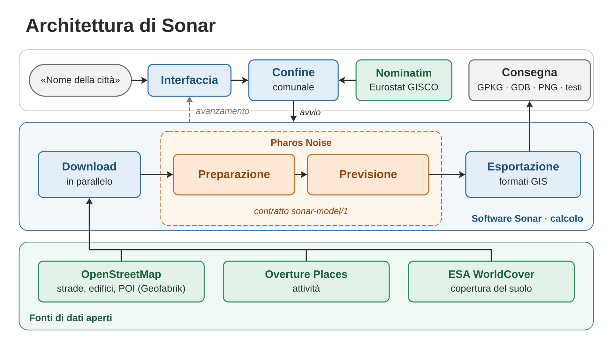
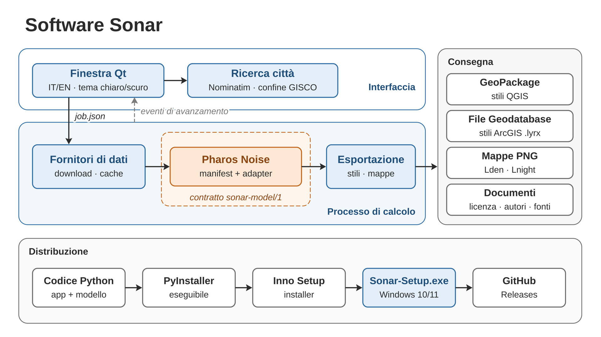
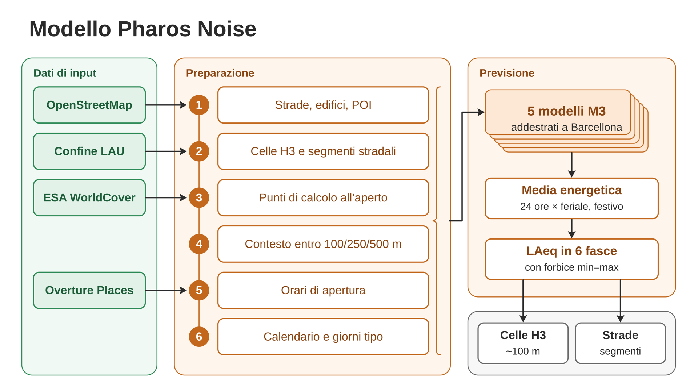

<p align="center">
  <picture>
    <source media="(prefers-color-scheme: dark)" srcset="sonar_app/assets/logo_dark.png">
    
  </picture>
</p>

<h3 align="center">
  <a href="https://github.com/ivan-murano/sonar/releases/latest/download/Sonar-Setup.exe">⬇ Scarica Sonar per Windows · Download Sonar for Windows</a>
</h3>
<p align="center"><code>Sonar-Setup.exe</code> · Windows 10/11 64 bit · circa 170 MB</p>

**Sonar** calcola la mappa del rumore urbano di una città europea a partire dal suo nome. Si scrive la città, si preme *Avvia*: Sonar trova il confine comunale, scarica i dati aperti che servono, applica il modello acustico **Pharos Noise** e consegna una cartella pronta per QGIS e ArcGIS, con il livello sonoro stimato ogni 100 metri e su ogni tratto di strada, ora per ora, in un giorno feriale e in un festivo. Tutto gira sul proprio PC, senza account e senza dati da preparare: per una città come Parigi bastano circa dieci minuti.

*Sonar maps urban noise for any European city from its name. It finds the municipal boundary, downloads open data, runs the Pharos Noise model and delivers a GIS-ready folder with estimated sound levels every 100 m and on every road segment, for a weekday and a holiday, in six time bands. It runs on your own PC; Paris takes about ten minutes.*

## Perché

Il rumore ambientale è uno dei principali rischi ambientali per la salute in Europa: l'Agenzia europea dell'ambiente stima circa 73.000 morti premature all'anno legate all'esposizione a lungo termine ([EEA 2025](https://www.eea.europa.eu/en/analysis/publications/environmental-noise-in-europe-2025)), con effetti documentati su sonno e salute cardiovascolare ([Razai et al., BMJ 2025](https://www.bmj.com/content/391/bmj-2024-081193)). Le mappe acustiche ufficiali coprono solo gli agglomerati più grandi, si aggiornano ogni cinque anni e richiedono rilievi e modelli di traffico costosi. Sonar dà a qualsiasi comune, piccolo o grande, una mappa dettagliata in pochi minuti, da usare per individuare le zone più esposte, decidere dove misurare e valutare le scelte di pianificazione.

## Come si usa

1. Installare Sonar con `Sonar-Setup.exe` (link qui sopra). Python, Qt, GDAL e il modello sono inclusi; non servono diritti di amministratore. Windows può mostrare l'avviso SmartScreen perché l'installer non è firmato: *Ulteriori informazioni → Esegui comunque*.
2. Scrivere il nome della città e premere **Avvia** (Invio mostra prima il confine trovato; se il nome è ambiguo Sonar chiede quale luogo si intende).
3. Scegliere la cartella di destinazione. La barra mostra ogni passo; alla fine compare **Apri cartella**.

Lingua (italiano/inglese) e tema (chiaro/scuro) si cambiano in basso a destra; la lingua vale anche per i nomi di file e cartelle della consegna. Serve una connessione a internet e 1–2 GB di spazio per i dati in cache.

## Cosa si ottiene

```
Sonar_<Città>_<AAAA-MM-GG_HHMM>/
  Risultati/
    GeoPackage/         celle H3 (~100 m) e strade, con gli stili QGIS già applicati
    File Geodatabase/   gli stessi layer per ArcGIS Pro, con gli stili .lyrx
    Mappe/              una tavola PNG per output: Lden e Lnight, giorno feriale e festivo
  Dati di input/        confine comunale, OpenStreetMap, Overture Places, ESA WorldCover
  LEGGIMI.txt  LICENZA.txt  AUTORI.txt  fonti_dati.json  registro.txt
```

Per ogni cella esagonale di circa 100 m e per ogni segmento stradale (al massimo 50 m):
- **LAeq** in sei fasce orarie (00–06, 06–09, 09–13, 13–17, 17–21, 21–24) per un giorno feriale scolastico e per una domenica o festivo, con la forbice minimo–massimo dei cinque modelli;
- **Lden** e **Lnight**, gli indicatori della Direttiva europea 2002/49/CE e delle linee guida OMS, calcolati sommando l'energia sonora delle fasce con le penalità della direttiva (sera +5 dB, notte +10 dB). Sono lo stile predefinito dei layer.



## Il software

Sonar è un'applicazione Windows scritta in Python con interfaccia Qt.

- **Interfaccia.** Cerca la città con [Nominatim](https://nominatim.openstreetmap.org) e ne prende il confine comunale ufficiale dalle unità LAU di [Eurostat GISCO](https://ec.europa.eu/eurostat/web/gisco).
- **Processo di calcolo.** Il lavoro gira in un processo separato, che riporta l'avanzamento all'interfaccia e si può annullare. Scarica in parallelo i dati del modello: l'estratto [OpenStreetMap](https://www.openstreetmap.org) di [Geofabrik](https://download.geofabrik.de) ritagliato sulla città, le attività di [Overture Maps Places](https://docs.overturemaps.org) e la copertura del suolo [ESA WorldCover](https://esa-worldcover.org). Gli estratti regionali restano in cache per le città vicine.
- **Modello come modulo.** Il modello è un pacchetto separato in `models/`, collegato dal contratto [`sonar-model/1`](docs/MODEL_CONTRACT.md) (un manifest e un adattatore): si può aggiornare o sostituire senza toccare il software. Le fasi più pesanti del modello girano su tutti i core del PC, con risultati identici al calcolo in un solo processo, verificati a ogni esecuzione.
- **Esportazione.** GeoPackage con stili QGIS, File Geodatabase con stili ArcGIS Pro, tavole PNG e i documenti della consegna (licenza, autori, fonti con data e versione di ogni dato).



## Il modello Pharos Noise

Pharos Noise è un modello di **machine learning** che impara il legame fra la forma della città e il rumore misurato. È addestrato sulla rete di sensori acustici della città di Barcellona (oltre 350.000 ore di misure orarie) con il metodo *gradient boosting*, che cerca da solo la combinazione di variabili con l'errore più piccolo fra livello misurato e livello stimato.

**Come stima il rumore in una città nuova**
1. Legge da OpenStreetMap strade, edifici e punti di interesse.
2. Divide il comune in celle esagonali H3 di circa 100 m e la rete stradale in segmenti di al massimo 50 m.
3. Sceglie per ogni cella e segmento un punto di calcolo all'aperto: fuori dagli edifici, dentro il comune, non sull'acqua (le aree d'acqua vengono da ESA WorldCover).
4. Descrive il contesto di ogni punto entro 100, 250 e 500 m: lunghezza delle strade (tutte, principali, a scorrimento veloce), copertura degli edifici, punti di interesse per categoria (ristorazione, vita notturna, scuole, commercio, sanità, trasporti, uffici…).
5. Assegna a ogni attività di Overture un profilo di orari di apertura (osservato quando disponibile, altrimenti tipico per categoria) e conta, ora per ora, quante attività sono aperte attorno a ogni punto.
6. Costruisce il calendario del paese: festività nazionali e giorni di scuola.

Poi **cinque modelli** addestrati su cinque suddivisioni diverse dei dati di Barcellona stimano il LAeq per ognuna delle 24 ore del giorno feriale e del festivo. Le ore sono combinate nelle sei fasce sommando l'energia sonora; la media dei cinque modelli dà la stima, i loro estremi la forbice.

**Quanto è accurato.** Sulle 30 postazioni di Barcellona mai usate per l'addestramento la stima oraria ha un errore medio di **3,6 dB** e una correlazione di **0,88** con le misure; a livello di fascia oraria l'errore medio è di **3,1 dB**, e la differenza fra giorno e notte è riprodotta quasi esattamente (6,85 dB stimati contro 6,83 misurati). Sono valori in linea con gli studi recenti più vicini, che riportano errori quadratici medi fra 4,4 e 4,9 dB con dati e protocolli diversi ([Helbich et al. 2025](https://doi.org/10.1016/j.scs.2025.106169), [Haselhoff et al. 2026](https://www.nature.com/articles/s41370-026-00855-w)). La verifica su una seconda città, Dublino (rete di sensori Sonitus), è in corso con un protocollo fissato prima di vedere i dati.

Spiegazione completa: [docs/MODEL.md](docs/MODEL.md).



## Fonti e licenze dei dati

| Dato | Uso | Licenza |
|---|---|---|
| [OpenStreetMap](https://www.openstreetmap.org/copyright) via Geofabrik | strade, edifici, punti di interesse | ODbL 1.0 (i risultati sono opere derivate) |
| [Overture Maps Places](https://docs.overturemaps.org/attribution/) | attività e orari | CDLA Permissive 2.0 e licenze dei fornitori |
| [ESA WorldCover 2021](https://esa-worldcover.org) | aree d'acqua | CC BY 4.0 |
| [Eurostat GISCO LAU](https://ec.europa.eu/eurostat/web/gisco/geodata/statistical-units/local-administrative-units) | confine comunale | © EuroGeographics, uso non commerciale |
| [Nominatim](https://nominatim.openstreetmap.org) | ricerca della città | policy d'uso OSMF (una richiesta per ricerca) |

## Autori e licenza

Ivan Murano e Laura Ripoli. Software e modello sono distribuiti secondo [LICENSE.txt](LICENSE.txt); le licenze delle librerie incluse sono in [THIRD_PARTY_NOTICES.md](THIRD_PARTY_NOTICES.md).

## Sviluppo

```
py -3.12 -m venv .venv
.venv\Scripts\python -m pip install -r requirements-build.txt
set SONAR_MODEL_CODE=D:\noise_pollution          rem codice del modello Pharos Noise
.venv\Scripts\python -m sonar_app                rem interfaccia
.venv\Scripts\python -m sonar_app --selftest     rem controllo dell'installazione
.venv\Scripts\python -m pytest tests
build\BUILD_WINDOWS.cmd                          rem eseguibile e installer (build\output\Sonar-Setup.exe)
```

Documentazione tecnica: [contratto del modello](docs/MODEL_CONTRACT.md), [passaggio di consegne del software](docs/HANDOFF.md), [passaggio di consegne del modello](docs/HANDOFF_MODEL.md).
